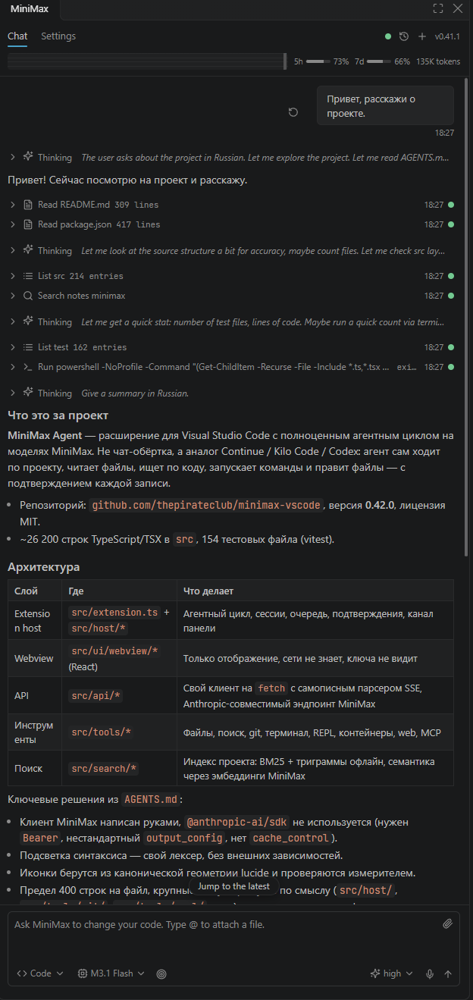
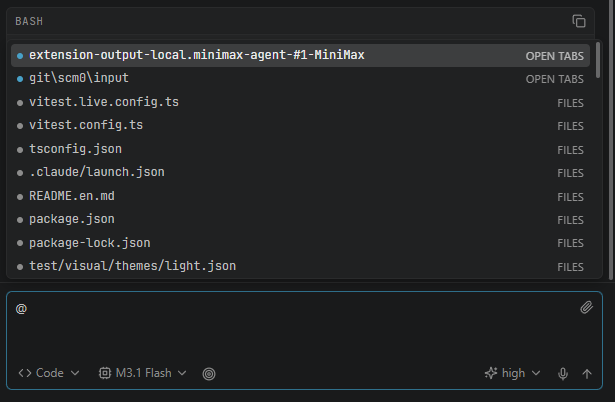
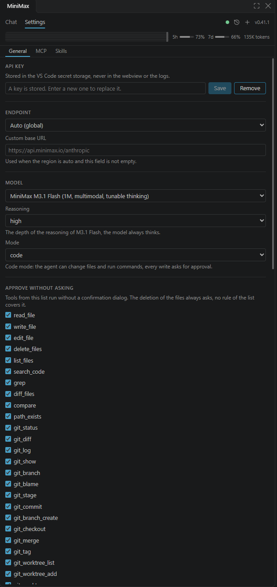
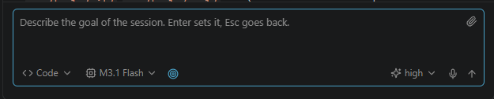
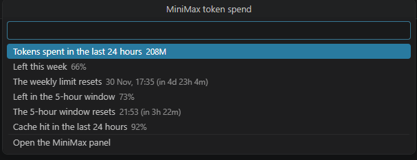
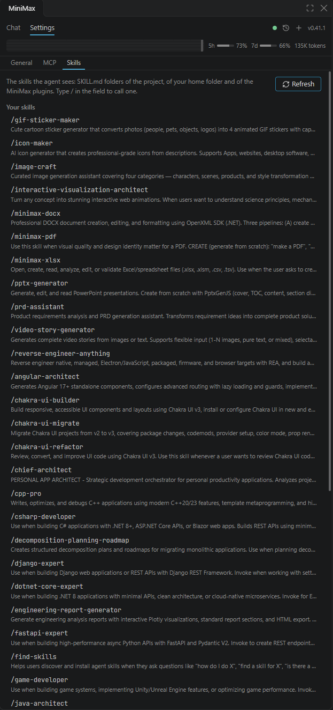
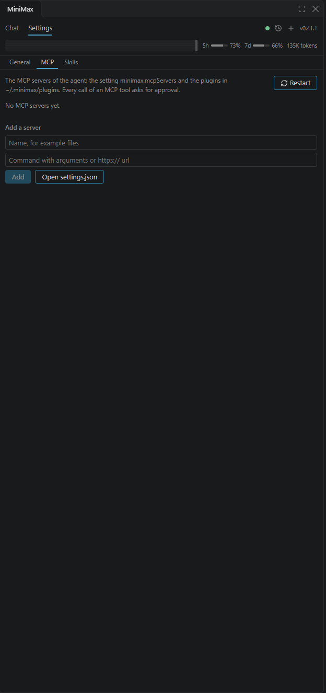
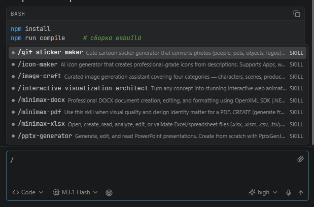

# MiniMax Agent

[Russian version of this file](README.md)

A VS Code extension with a full coding agent powered by MiniMax models. The agent lives in the side panel, keeps its own conversation history, and calls tools against your project. Every write to disk and every command run asks for explicit confirmation.



## Features

- Chat with MiniMax M3.1 Flash and MiniMax M3 in the right-hand VS Code panel (Secondary Side Bar)
- Streaming answers with a collapsible thinking block: the folded block shows the first words of the reasoning in a single italic line, a click on the line or the header unfolds it
- Agent actions are grouped into Actions sections: a folded group shows the last action in a single italic line (for example `read_file src/tools/git.ts`), a click on the line or the header opens the action cards
- File references live right in the input field: typing `@` opens suggestions for open tabs and for project files, the chosen file becomes a chip inside the field showing only its name with the extension
- Agent mode, model and reasoning level sit in the bottom row of the input field as narrow icon selectors
- One reasoning switch next to the send button: for M3.1 Flash it holds the depth levels, for M3 it holds only `Off` and `Adaptive`, because the M3 server ignores the depth
- Voice input: the microphone button in the input field records speech through ffmpeg and turns it into text with MiniMax, the live text appears in the field while recording
- Chat history in the header: a list of saved sessions, deletion, a new chat, the active chat survives a window reload
- A chat belongs to a project: by default the list shows the chats of the current project, chats of other projects stay in the list and are visible through the `All chats` switch. Every project has its own open chat: opening a project opens the chat that was active in it, and if there are none, a new one is created
- Message queue: while the agent works, the next requests are not lost but wait for their turn above the input field. Every message has its own state (waiting, sending, sent, error), it can be sent on its own or deleted, and the `Send all` button sends the whole queue and repeats the failed ones
- A lost connection to the API does not leave you with an empty answer: the request repeats itself with a growing pause (1s, 2s, 4s and further, up to 30s), the input field shows `Connecting... attempt 2 of 5`, the number of retries is configurable
- The message feed follows the answer, the `Jump to the latest` button brings it back down
- Task list: the model keeps the plan through the `todo_write` tool, it is visible in the widget above the feed and survives a window reload, the list can be cleared completely with a button in the widget header
- Goal with limits: the goal is set by a target button in the input field or by the `/goal` command, then a three-step wizard (goal, limits, check) and a widget above the feed. The agent counts the spend of every request and stops on its own when the budget runs out. Only you raise the limits, the model cannot, and the status of the goal does not switch the auto-stop off
- Sub-agents: the model hands part of the work to a child through the `task` tool, it has its own history and its own role (`explore` reads, `worker` makes changes, `verifier` checks), the log and the answer of the child are visible in the call card
- Answers arrive in markdown: headings, lists, tables, code blocks with a language label and a `Copy` button
- Syntax highlighting in code blocks: keywords, strings, comments, numbers and function names are colored, the palette follows the VS Code theme
- A code block from a project file is signed with the file name and the line number, a click on the signature opens the file in the editor at that line; generated code keeps the language label
- A code block always has a name: the file and the line if it is a piece of the project, the command if the block quotes its output, `Output` otherwise
- Action cards: an icon, what was done, how many lines and how much time it took, the duration grows from milliseconds to seconds and minutes
- The step time sits in the last message of the step: how long the agent turn took
- A stopped agent always explains itself: the iteration limit, the token limit or your own stop command arrive as a separate notice
- A request can be repeated and rolled back: the buttons sit only at your messages. `Go back to this point` stands to the left of the message, the arrow points at it: a click rolls the chat back to your message, the message returns to the input field, the answers after it disappear, the agent waits for the next command. `Repeat the request` appears only when a turn failed, it repeats the request with the same files and selections
- `read_file` reads several files in one call
- Token spend graph in the panel header: a bar per action plus a counter for the whole session, the values are rounded with the prefixes K, M, B
- Project index: lexical search (BM25 and trigrams) works offline, the semantic layer is switched on by a setting and sends the code to the MiniMax server
- Search like in findstr: several words through `patterns`, case through `ignore_case`, a path to a specific file, hidden folders like `.worktrees` are searched too
- The command `MiniMax: Rebuild Project Index` rebuilds the project index
- The panel font size is configurable, the whole layout scales with it
- The agent status is shown as a colored dot: while an action runs the dot blinks gray, a finished action burns steady green, an error burns red
- Sending is a round icon in the bottom right corner of the input field, the mode, model and reasoning selectors stand in the bottom row of the same field
- The prompt field is taller, a long task fits in it
- The answer limit comes from the model catalog, not from a setting
- History trimming: how many messages to keep and how much of the context window the conversation may take
- A file is attached with a clip in the corner of the input field, the separate Attach button is gone
- Two agent modes: `plan` studies the project and answers with a plan, `code` gives access to writing files and to the terminal
- Code selected in the editor goes to the chat as a separate chip
- A settings tab next to the chat: key, endpoint, model, effort, limits, auto-approval
- Tools: `read_file`, `write_file`, `edit_file`, `list_files`, `search_code`, `run_terminal`, `todo_write`, `get_goal`, `update_goal`, `task`, the git tools and the worktree tools
- A diff preview before the write and a confirmation card before every command
- Terminal commands on Windows run in PowerShell (pwsh, then powershell), on other systems in sh, the prompt of the model names the same shell
- Project rules are picked up from `AGENTS.md`, `.github/copilot-instructions.md`, `CLAUDE.md` and `.cursorrules`
- The badge in the bottom right corner of VS Code shows the remaining 5-hour limit in percent, a click on it opens the numbers: the spend of the day, the remainder of the week, the remainder of the 5 hours and the cache hit in percent
- The button with a sparkle in the Source Control panel writes the commit text by the changes of the repository and puts it into the message field
- Undo of the last file change with the command `MiniMax: Undo Last File Change`
- Local session history, it never leaves the machine

## Requirements

- VS Code 1.106 or newer
- A MiniMax API key: an M Plan subscription key or a pay-as-you-go key

## Setup

1. Open the command palette and run **MiniMax: Add API Key**. The key is stored in the VS Code secret storage and nowhere else.
2. Run **MiniMax: Set Endpoint** and choose Global (`api.minimax.io`) or China (`api.minimaxi.com`).
3. Optionally run **MiniMax: Select Model**, **MiniMax: Set Thinking Effort** and **MiniMax: Set Agent Mode**.
4. Open the MiniMax panel in the right-hand panel of VS Code and set the task.

Every setting is available right in the panel: the **Settings** tab next to the **Chat**. The key is set there too if it was not added by the command.

Voice input is configured there as well: **Language** (an empty value turns auto-detection on) and **Microphone**. The dictionary of foreign words (`minimax.speechVocabulary`) and the path to ffmpeg (`minimax.ffmpegPath`) are set in the VS Code settings.

The key can also be put into a `.env.local` file in the root of the project, the variable `MINIMAX_API_KEY`. The file is in `.gitignore` and never reaches the repository. The secret storage has the priority, `.env.local` is the fallback source.

## Commands

| Command | What it does |
| --- | --- |
| `MiniMax: Open Panel` | open the agent panel |
| `MiniMax: New Chat` | start a new session |
| `MiniMax: Add API Key` | store the key in the secret storage |
| `MiniMax: Clear API Key` | remove the key from the secret storage |
| `MiniMax: Set Endpoint` | choose the region or a custom base URL |
| `MiniMax: Select Model` | choose the model |
| `MiniMax: Set Thinking Effort` | choose the reasoning level (`low` … `max`) |
| `MiniMax: Set Agent Mode` | choose the agent mode: `plan` or `code` |
| `MiniMax: Undo Last File Change` | roll back the last file change |
| `MiniMax: Refresh Workspace Context` | reread the rules and the structure of the project |
| `MiniMax: Rebuild Project Index` | rebuild the project index for the search |
| `MiniMax: Show Logs` | open the MiniMax output channel |
| `MiniMax: Show Token Spend` | show the token spend of the day and the remainder of the limit |
| `MiniMax: Generate Commit Message` | write the commit text by the changes of the repository |
| `MiniMax: Add Selection to Chat` | send the code selected in the editor to the chat |
| `MiniMax: Add File to Chat` | add a file reference to the input field |

## Working with files

The reference to a file lives in the input field itself, so you can refer to it anywhere in the phrase.

- Type `@` in the input field: a list of open tabs and project files appears. The arrows pick an item, Enter inserts the reference.
- The inserted reference looks like a chip right in the input field: only the file name with the extension is visible, the full path stays inside the chip. The cross on the chip removes the reference.
- You can type the reference by hand, the format is the same (`@path/to/file`). On sending the extension host finds the file inside the workspace itself and attaches its content to the request.
- `MiniMax: Add File to Chat` in the context menu of a file inserts the same reference.
- `Ctrl+Alt+M` (`MiniMax: Add Selection to Chat`) turns the selected code into a chip above the input field. The chip is visible, it can be removed, and the code itself goes to the model as a separate block.



## Commit text

The Source Control panel has a button with a sparkle. It looks at the changes of the repository and writes the commit text into the message field.

- The button lives in the header of the Source Control panel next to the commit and refresh buttons. The actions in the header appear when the panel has the focus.
- The extension takes the index of the changes (staged) and, if nothing is prepared, the diff of the working directory. New files that are not in the index yet are added separately, otherwise a commit with a new file would go unnoticed.
- The command `MiniMax: Generate Commit Message` does the same from the palette.
- The text follows the rules of Conventional Commits, the line is in Russian, in the imperative: `feat: add the generation of the commit text`.
- The model receives only the changes, it needs no tools.
- If there is no repository, the finished text goes to the clipboard.

## Search in the project

The agent searches the project through an index that the extension builds itself.

- The index is built in the background when the extension starts and is updated when a file on disk changes, appears or disappears. The command `MiniMax: Rebuild Project Index` rebuilds it from scratch.
- The lexical layer works offline and is always on: the rank of the files is computed by BM25, words are split into parts by camelCase and snake_case, and if an exact word is not found, the fallback catches a typo by trigrams.
- The semantic layer is switched on by the `Semantic search` setting in the Settings tab. It cuts the files into overlapping chunks and asks MiniMax for `embo-01` embeddings, and the lists of the lexical and the semantic search are merged.
- The layer is off by default: it sends the code of the project to the server. On a subscription key of the M Plan the endpoint of the embeddings answers with a refusal by the request limit, and in this case the search returns the lexical result with a note that the semantic layer did not work.
- The tool `search_code` has the parameter `mode`: `auto` takes the lexicon and adds the semantics when it is on, `lexical` searches by words only, `semantic` by meaning only, `hybrid` always mixes both lists.
- Besides the index there is a search like in findstr: the parameter `patterns` takes several words (any of them fits), `ignore_case` turns the case off, `path` points to a single file or to a folder. This search goes straight through the files, so it finds the hidden folders like `.worktrees` that are not in the index. The lines of the answer carry their numbers: `path/file.js:310: text`.

## The look of the panel

- The font size is set by the `Font size` setting in the Settings tab. The panel scales as a whole, all the sizes in css are counted from the base variable.
- The status of the agent in the header and in the action card is a colored dot: while the action runs the dot blinks gray, a finished action burns steady green, an error burns red. The text of the status stays in the tooltip.
- The token counter and the labels of the graph are rounded with the prefixes: `K` is a thousand, `M` is a million, `B` is a billion.
- Under the graph of the token spend there is a grid, the bars are read by eye.
- The graph stretches over the whole width of the header: the bars share the free space instead of growing with the number of steps.
- The bottom row of the input field is the control panel: on the left the mode, the model and the goal button with a target, on the right the reasoning switch, the microphone and the send button.
- The goal button with a target turns the field from the request mode into the goal mode: the frame of the field and the button become accent, Enter sets the goal from the text of the field, Escape returns the ordinary request.
- The send button stands in the bottom right corner of the input field and is drawn by an icon from the set of icons of VS Code, the send arrow. While the agent works, a stop square takes its place.
- To the left of your message stands exactly one button: the rollback arrow `Go back to this point`. When a turn failed, a round button `Repeat the request` takes its place. Both buttons share one slot, so the panel never shows two of them at once.

The model keeps the task list through the `todo_write` tool. It is visible in the widget above the feed and survives a window reload, a click on a task changes nothing: the list is changed by the model. The whole list can be cleared with a button in the header of the widget, next to the fold button.

The Settings tab gathers everything in one place: the key, the API address, the model, the reasoning depth, the mode, the list of tools that run without a confirmation.



## Goal with limits

The goal is set by the user, the model only reads it and changes its status.

- The goal is set from the input field: the target button in the bottom row turns the field into the goal mode, Enter sets the goal from the text of the field, Escape returns the ordinary request.
- The command `/goal` with the text in the input field sets the goal at once with the default limits, `/goal` without text opens the wizard. The command does not go to the model and works while the agent is busy.
- The creation and the edit of the goal go through a wizard of three steps: goal, limits and check. Enter goes forward and saves on the last step, Shift+Enter moves the line of the goal, Escape closes the wizard.
- The limits step has three fields, by tokens, by requests and by minutes. An empty field means no limit, a wrong number is an error, the limit is not lifted by it.
- The widget of the goal stands above the feed and shows the text of the goal, the spend (tokens, requests, time) and the buttons `Edit` and `Clear`.
- The agent counts the spend of every request and stops on its own when the budget runs out, the panel explains the stop with a notice.
- Only you raise the limits. The model can mark the goal as done or blocked, but it cannot raise the limit and it cannot switch the auto-stop off with the status.
- A raised limit keeps the money already spent: the work continues from the same place, the counter of the spend is not reset.
- The goal lives with the session and survives a window reload.



## Voice input

The microphone button stands in the bottom row of the input field, right before the send button. It records the speech and turns it into text.

- The recording goes to the extension host through ffmpeg: the webview of VS Code has no access to the microphone. The raw samples of mono 16 kHz stay in memory, the recording goes up to 480 seconds and is stopped by the microphone button.
- MiniMax `asr-1.0` recognizes it with the same key as the requests to the model, the answer arrives as a stream: the live text appears in the field during the recording, the final one becomes an ordinary text next to the draft.
- The dictionary of foreign words lives in the setting `minimax.speechVocabulary`: a bare term (`PreSonus`) replaces a word that sounds like it, a pair replaces the heard word exactly. Without the dictionary a Russian phrase records the foreign names in Cyrillic.
- The language is set by `minimax.speechLanguage`, an empty value turns auto-detection on. The microphone (`minimax.microphone`) and the path to ffmpeg (`minimax.ffmpegPath`) are set too, the panel has the fields `Language` and `Microphone`.
- The key is checked before the microphone opens, any error ends with a notice in the panel, the button returns to its original state.

## Trimming the history

The conversation history is trimmed in two places, both thresholds are configurable in the Settings tab.

- `Compacting` sets how many of the last messages of the conversation stay in the dialog.
- `Context threshold` sets what share of the context window of the model the conversation may take, in percent. The share is counted from the window of the model, a rough estimate of the tokens is taken from the length of the text.

The message limit works after a window reload too: the saved copy of the chat keeps as many messages as the setting allows, with a separate ceiling by characters, so the state of the host does not swell from giant chats.

Before every request the history is repaired: a tool call without an answer and a result without a call are removed, and the text of the request does not merge with the message that carries the result of the call. Without this MiniMax answers with the error `invalid params, tool call result does not follow tool call (2013)` and the turn does not start. The rollback to the request cuts the history at the same border, a call always stays together with its result.

## Limit and status bar

In the bottom right corner of VS Code lives the badge `MiniMax`. In the brackets after the name stands the remainder of the 5-hour window of the limit in percent, for example `MiniMax (96%)`. The tooltip shows the remainder of the week and the time until the window resets.

The badge is updated when the extension starts, after every agent turn and every five minutes. The data comes from `GET https://api.minimax.io/v1/token_plan/remains` with the same key as for the requests to the model.

A click on the badge opens the list of the numbers:

- the token spend of the last day;
- the remainder of the week in percent;
- the remainder of the 5-hour window in percent;
- the cache hit of the day in percent, the share of the input tokens that was read from the cache.

The remainders of the windows come from the server, and the spend of the day and the cache hit are counted by the extension itself by the log of the requests: the server gives only the percents and the time until the reset. A separate item of the list is the jump to the agent panel.

## Agent modes

The mode is switched by the `Mode` selector under the input field, in the Settings tab and by the command `MiniMax: Set Agent Mode`.

- `plan` (read only): the agent gets `read_file`, `list_files`, `search_code` and the reading of the repository (`git_status`, `git_diff`, `git_log`, `git_show`, `git_branch`, `git_blame`, `git_worktree_list`). It studies the project and answers with a concrete plan: which files to change and what exactly to change in them. The tools of writing and the terminal are not visible to the model in this mode, and an attempt to call them is rejected.
- `code` (full access): all the tools are available, every write and every command goes through the confirmation as usual.

The mode acts from the next turn: the list of the tools and the system prompt are rebuilt together with the session, the history of the dialog is kept.

## Chat history

The button with the clocks in the header opens the list of the saved chats. From there you can open a past chat, delete it or start a new one. The history lives in the state of the VS Code extension and survives a window reload: the active chat opens again at the next start.

The list shows the chats of the project that is open now. The switch in the header of the list (`All chats`) lifts the filter and shows the chats of all the projects, every chat shows its label of the project. Nothing is deleted when the project is switched: the chats simply wait for their project, and every project has its own open chat.

To keep the storage from swelling, everything has a ceiling: 50 chats, 400 messages in a chat, 120 messages of the conversation history and 200 000 characters per message. The old is dropped, so the panel does not fall on a long conversation.

## Token spend

In the header of the panel lives the graph of the spend: one bar per agent action, the height is proportional to the sum of the tokens of that action. The input tokens (the context of the request, including the reading from the cache) are drawn in a muted color, the output (the answer of the model) in the accent. Next to it stands the counter for the whole session.

The tooltip of a bar shows the details, for example `Action 1: in 389814 (353044 cached), out 11922`. The history of the spend is stored with the session, so the graph survives a window reload.

A click on the badge in the status bar opens the same numbers: the spend of the day, the remainder of the week, the remainder of the 5-hour window and the cache hit.



## The reasoning of the model

MiniMax M3.1 Flash has the levels of the reasoning depth (`output_config.effort`). MiniMax M3 does not have them: the server ignores `effort` and `reasoning_effort`, the model picks the depth itself. Therefore the bottom row of the input field holds one reasoning switch, but its content depends on the chosen model.

- M3.1 Flash: `low`, `medium`, `high`, `xhigh`, `max`. The model always thinks.
- M3: `Off` (a request without a thinking block) and `Adaptive` (a request with `thinking: {type: 'adaptive'}`).

The same selector is in the Settings tab. The settings `minimax.effort` and `minimax.thinking` are kept as they are: the first answers for the level at M3.1 Flash, the second for the `Adaptive` mode at M3.

## The format of the answer

The answer format is prescribed to the agent: headings, short paragraphs, lists and code blocks with a language. The markup is rendered in the panel: a code block has a language label and a `Copy` button, the check lists stay checkboxes.

If a code block quotes a file of the project, the panel signs it with the file name and the line number, and a click on the signature opens the file in the editor at the right line. The code that the model wrote itself keeps the language label.

The look is colored, not gray. The headings, the bullets of the lists, the links and the inline code take the accent color of the theme, and the code inside the block is highlighted by syntax: keywords, strings, comments, numbers and function names get their own shades. The palette depends on whether the theme of the editor is light or dark, the contrast themes get the brightest shades.

## Tools

| Tool | Confirmation | Modes | What it does |
| --- | --- | --- | --- |
| `read_file` | no | plan, code | reads a text file with the line numbers, there is a range `start_line`/`end_line`; you can pass `paths` and read up to 12 files in one call |
| `write_file` | yes | code | creates a file or replaces it as a whole, the diff is shown before the write |
| `edit_file` | yes | code | replaces an exact string, `old_string` has to occur exactly once |
| `list_files` | no | plan, code | shows the structure of the project, `node_modules` and `.git` are ignored |
| `search_code` | no | plan, code | searches the text in the index of the project, the modes `auto`, `lexical`, `semantic`, `hybrid`; it also knows how to search like findstr: `patterns`, `ignore_case`, `path` |
| `git_status`, `git_diff`, `git_log`, `git_show`, `git_branch`, `git_blame` | no | plan, code | read the repository and change nothing in it |
| `git_stage`, `git_commit`, `git_branch_create`, `git_checkout` | yes | code | write to the index, make a commit, create and switch the branches |
| `git_worktree_list` | no | plan, code | shows the list of the worktrees with the branch and the commit |
| `git_worktree_add`, `git_worktree_remove` | yes | code | add and remove the worktrees, the path is given relative to the workspace and does not leave its borders |
| `run_terminal` | yes, always | code | runs a command in the root of the workspace with a timeout and a trimming of the output; the git and worktree commands are forbidden, they have their own tools |
| `todo_write` | no | plan, code | writes the task list of the session as a whole, a new list replaces the old one |
| `get_goal` | no | plan, code | reads the goal of the session with the limits and the spend of the budget |
| `update_goal` | no | plan, code | marks the goal of the session as done or blocked, the limits are changed only by the user |
| `task` | no, the write of the child asks | code | starts a sub-agent: its own history, its own prompt, its own set of tools by the role, the nesting is not deeper than one level |

## Sub-agents

The model can hand part of the work to a sub-agent through the `task` tool. The child has its own history, its own system prompt (the prompt of the parent plus the role) and its own set of tools.

- The role sets the set of the tools: `explore` only reads, `worker` makes the changes, `verifier` checks the work.
- The log of the child is visible in the call card: the lines of its actions go into the card, its answer returns into the turn of the parent.
- The write of a file by the child asks for the confirmation, as the parent does.
- The spend of the child goes into the account of the session and of the budget of the goal once, in the graph of the spend it is added to the action of the parent.
- The child does not start a child: the depth of the nesting is one.

## Skills and MCP

The panel works with skills in the `SKILL.md` format and with MCP servers.

- The skills come from the disk: `.minimax/skills` and `.claude/skills` of the project, `~/.minimax/skills`, `~/.claude/skills`, `~/.agents/skills` of the user and the packages of the plugins. A skill of the project wins over a skill of the user with the same name.
- The `Skills` section of the turn holds the names and the descriptions, the body of the skill is read by the `read_skill` tool.
- A `/` in the input field after a space or at the start shows the skill suggestions, Tab or Enter picks one, the full name becomes a chip.
- The MCP servers come only from the places of the user: the setting `minimax.mcpServers` and `*.mcp.json` of the plugins in `~/.minimax/plugins`. A file of the workspace never starts a server.
- The tool of a server is named `mcp__server__tool`, every call asks for the confirmation.







## Development

```bash
npm install
npm run compile
npm run watch
npm test
npm run typecheck
npm run package
```

Open the extension in VS Code with F5 or install the built file:

```bash
code --install-extension minimax-agent-0.42.0.vsix --force
```

The name of the file repeats the version from `package.json`.

The extension in the editor is loaded from the installed `.vsix`, the working copy is not picked up by itself. After the install you need to reload the window.

## Live tests

The live tests hit the real API and need a key:

```bash
npm run test:live
```

The key is taken from `MINIMAX_API_KEY` in the environment or from `.env.local` in the root of the project. The ordinary `npm test` does not run the live tests.

## Security

- Any write to disk and any run of a command require the confirmation in the panel, there is a button "Always allow in this session".
- The paths of the tools are resolved only inside the root of the workspace, leaving it is forbidden. This concerns the search too: a file outside the workspace is not read and does not get into the answer of the model.
- A ref that the model gives is not read as a git option: a separator of the options stands before the ref, so the model cannot point git to a file for writing.
- The settings of the API address (`minimax.customBaseUrl`, `minimax.baseUrl`), of the list of the confirmations (`minimax.autoApprove`) and of the path to ffmpeg (`minimax.ffmpegPath`) have the scope application: a repository that the user opens cannot override them. The API address is accepted only over https, a foreign host asks for the confirmation.
- The original of the file is saved before the write, it can be rolled back.
- The API key lives only in the secret storage of VS Code, it gets neither into the webview nor into the logs.

## License

MIT
